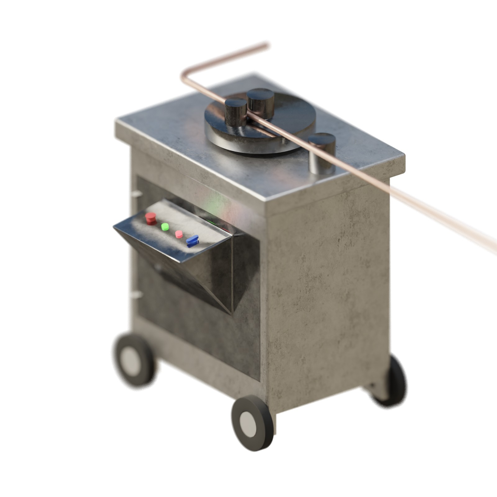
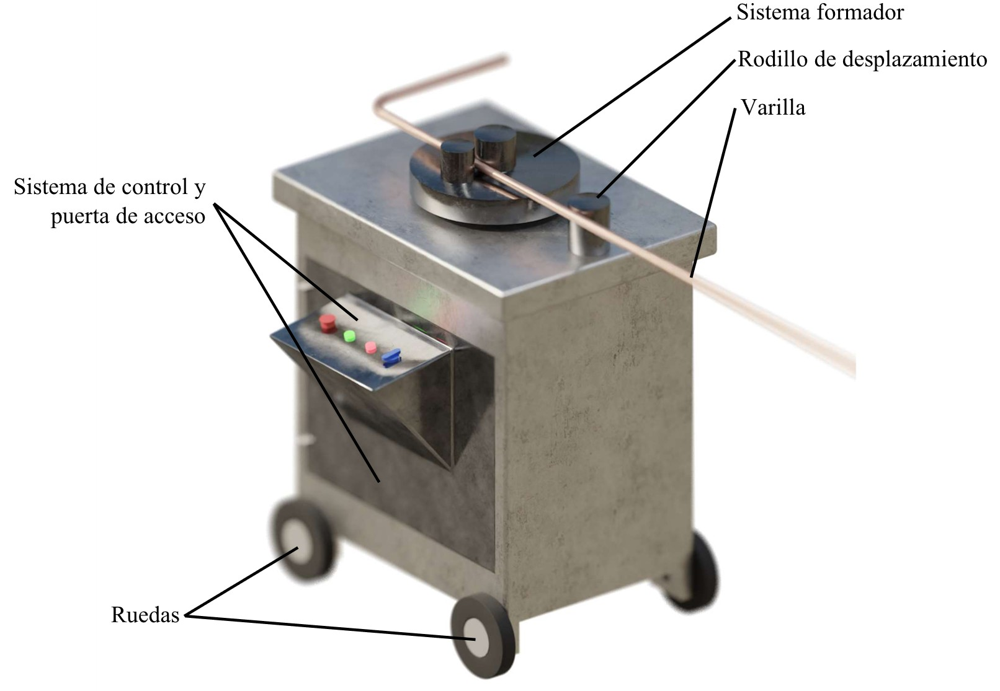
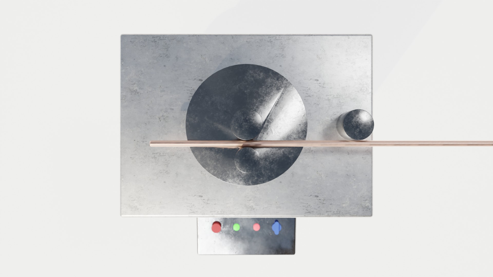
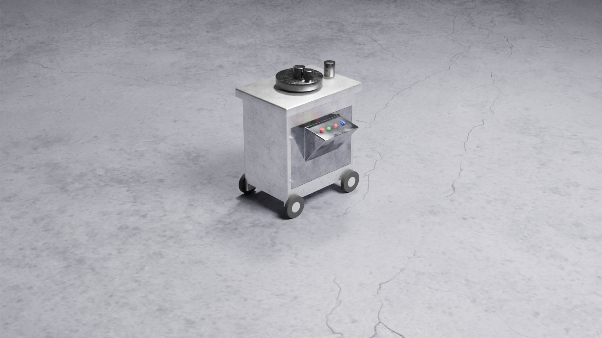
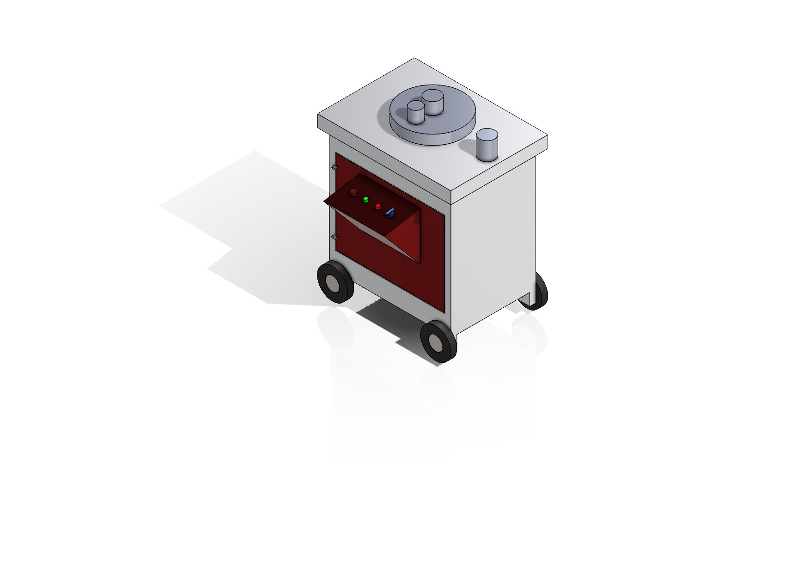

# Bar Bender

Design of an automatic bench bar bender driven by two servomotors: bending calculations, motor selection, servo drive parametrization, a budget, and a 3D model rendered and animated in Blender.

Full report: [Markdown](report/informe.md) or [PDF](report/informe.pdf) (in Spanish). Silent animation: [`media/animation.mp4`](media/animation.mp4).

## Problem / context

Second-term project of the Actuators course, Mechatronics Engineering, Universidad Militar Nueva Granada, 2021-2, with professor Luis Francisco Niño Sierra. Individual work.

Manual bending of steel bar is physically demanding and repetitive, and it gives inconsistent bend angles. The brief was to design a machine that feeds and bends bar automatically, size the bending motor, parametrize the servo drives and estimate the cost.

This is a paper design: the machine was not built or tested. The results below are hand calculations and software configuration screens.

## How it works

The machine is a press-type bender on a wheeled steel and aluminium cabinet.

| Function | Solution in the report |
|---|---|
| Hold the bar | The operator holds it by hand; the forming disc and its pins keep it in place. A clamping chuck was left out to reduce cost. |
| Feed the bar | A Siemens servomotor turns a high-friction roller. |
| Bend the bar | A Yaskawa servomotor turns the forming disc. |
| Detect the bar | An inductive sensor; if no bar is present, a warning lamp turns on. |
| Control the angle | An encoder on the forming shaft; both servos run in position control from a pulse train. |

### Bending calculations

Inputs: structural steel bar, diameter $D$ = 0.0256 m, yield strength $\sigma_y$ = 228 MPa (tensile strength 310 MPa), bending die radius $L$ = 0.0765 m, bending speed $\omega$ = 0.5 rad/s. Equations 1 to 21 of the report:

| Quantity | Equation | Result in the report |
|---|---|---|
| Second moment of area | $I=\frac{\pi}{64}D^4$ | 2.108 × 10⁻⁸ m⁴ |
| Plastic moment | $M_P=\frac{3\sigma_y I}{2C}$, with $C$ = 0.026 m | 277.28 N·m |
| Bending force | $F=\frac{6\sigma_y I}{C L}$ | 14 484.70 N |
| Design stress check | $\sigma_d=\frac{M_P C}{I}$ | 341.99 MPa > 228 MPa |
| Torque on the forming shaft | $T=F L$ | 1108.07 N·m (817.27 lbf·ft) |
| Power at 0.5 rad/s | $P=T\omega$ | 0.7429 HP |

The errors in this chain are listed under "What I learned and what is missing".

### Motor selection

From the Siemens SIMOTICS catalogue the report selects motor 1LE0141-0EC06-4AA4-Z as the cheapest option above the required power: 1 HP, 6 poles, 1130 rpm, 6.3 N·m rated torque, 73 % efficiency, power factor 0.81.

### Servo drive parametrization

- **Siemens (bar feed), in SINAMICS V-ASSISTANT:** SIMOTICS motor of 0.75 kW with a SINAMICS V90 drive, position control mode, basic positioner with the rotary table ("disc table") mechanism, pulse and direction input at 5 V.
- **Yaskawa (bending), in SigmaWin+ Ver. 7:** serial encoder, position control from a pulse train, sign plus pulse format, positive logic, rotary table as the mechanical structure, gear ratio 1:3 (three motor turns per load turn, figure 18) and 2048 encoder output pulses per revolution.

With 2048 pulses per revolution, the report plans each shape as a fixed number of pulses per bend: a square is 4 bends of 2048/4 = 512 pulses, and a triangle 3 bends of 2048/3 = 682 pulses. The report says an Arduino would send those pulses.

### Budget

| Item | Cost (Colombian pesos, 2021) |
|---|---:|
| Siemens motor | 803 000 |
| Yaskawa motor | 1 800 000 |
| Steel rollers | 130 000 |
| Aluminium sheets (×10) | 1 400 000 |
| Bearings | 25 900 |
| Electrical panel | 359 000 |
| Toothed belt | 60 900 |
| Proximity sensor | 96 500 |
| Encoder | 260 000 |
| Cables | 89 900 |
| **Materials total** | **5 025 200** |

Engineering is added at 15 % of materials: 753 780 pesos.

## Results and measurements

There are no physical measurements; everything here is calculated or rendered.

- Bending calculations, motor selection, parametrization and budget: listed above, taken from the report.
- Renders and animation: computer-generated imagery (CGI) made in Blender. The animation is 35.8 s, 1920×1080, 24 frames per second, H.264, no audio, 6.3 MB. It shows the machine, close-ups of the forming disc and the control panel, and the bar being bent.

| | |
|---|---|
|  |  |
| Report figure 7: parts of the machine | Top view of the bending system (Blender) |
|  |  |
| Render on a concrete floor (Blender) | Assembly in SolidWorks |

## How to reproduce

1. Read the report in [`report/informe.md`](report/informe.md) (equations render on GitHub) or [`report/informe.pdf`](report/informe.pdf).
2. The calculations are closed-form: they can be redone with a calculator from the inputs listed above (equations 1 to 21 of the report).
3. The parametrization screens (report figures 9 to 19) show every option chosen in SINAMICS V-ASSISTANT and SigmaWin+ Ver. 7, so the configuration can be repeated in those tools.
4. The CAD and Blender files are not published, so the renders cannot be regenerated from this repository.

## What I learned and what is missing

What this project taught me: to start a machine from a functional breakdown, to go from a load to a torque and then to a catalogue motor, and to parametrize real servo drives from two manufacturers. It also taught me to present a design with a 3D model, renders and an animation.

Reviewing it now, these are its limits and errors:

- **Paper design only.** Nothing was built or tested.
- **Wrong distance to the outer fibre.** The report uses $C$ = 0.026 m, which is the diameter. For a circular section $C = D/2$ = 0.0128 m. Using $C = D$ underestimates the moment: with $C = D/2$, equation 4 gives about 563 N·m instead of 277.28 N·m, and the plastic moment of a solid round section ($\sigma_y D^3/6$) is about 638 N·m. Carrying $C = D/2$ through the same equations, the torque becomes about 2253 N·m and the power at 0.5 rad/s about 1.13 kW (1.51 HP), more than the 1 HP motor selected.
- **Force and moment are not consistent.** Equations 7 and 16 together give $T = 6\sigma_y I / C = 4 M_P$: the torque used to size the motor is four times the plastic moment of equation 4, and the report does not explain why.
- **The stress check proves nothing.** By construction $\sigma_d = M_P C / I = 1.5\,\sigma_y$, so the check $\sigma_y < \sigma_d$ of equations 10 to 15 passes for any input.
- **Missing gear reduction.** The required torque on the forming shaft (1108 N·m at 0.5 rad/s) is about 176 times the rated torque of the selected motor (6.3 N·m at 1130 rpm). A reduction of roughly 176:1 is needed and the report does not size it. The only ratio in the report is the 1:3 entered in SigmaWin+ (figure 18), and it is not used in the pulse count: with that ratio, 512 motor pulses would turn the forming disc 30°, not 90°.
- **Motor choice not reconciled.** The power calculation selects a Siemens 1LE0 induction motor from the catalogue, while the same report says the bending is done by a Yaskawa servomotor, and the Siemens drive is parametrized for a 0.75 kW SIMOTICS servomotor that feeds the bar.
- **Control software not delivered.** The abstract mentions a control interface in Python and the development section describes an Arduino sending the pulses. There is no code for either in the project files.
- **Third-party figures removed.** Report figures 1 to 5 (background theory) are from books and websites. The original cites them, but I have no licence to redistribute them, so they are omitted from this version; their captions and references remain. The original numbering of figures and tables (two tables labelled "Tabla I") is kept as is.

## Credits

- **Author:** Javier Solís: calculations, motor selection, parametrization, CAD model, renders and animation.
- **Course:** Actuators, Mechatronics Engineering, Universidad Militar Nueva Granada, 2021-2. Professor: Luis Francisco Niño Sierra. The university logo appears in the header of the report PDF.
- **Renders and animation:** CGI made by Javier Solís in Blender. The two servomotor models in the 3D assembly are third-party manufacturer models whose source is unknown; they are not redistributed in this repository.
- **Environment lighting:** the HDRI (high dynamic range image) background of the animation is from [Poly Haven](https://polyhaven.com/), licensed CC0.
- **Software:** SolidWorks (CAD), Blender (rendering and animation), Siemens SINAMICS V-ASSISTANT and Yaskawa SigmaWin+ (servo drive parametrization), Microsoft Word.

### Differences from the original files

- The PDF was regenerated from a copy of the original Word file without the third-party figures 1 to 5 and with the document metadata cleaned. The rest of the content is unchanged.
- The animation was re-encoded without audio (the original used third-party sound effects).
- Not included: the professor's brief, the CAD and Blender project files, the 3D assembly mesh (it contains the third-party servomotor models), and third-party textures, models and sounds.

## License

Report, figures, renders and animation are licensed under [Creative Commons Attribution-NonCommercial-NoDerivatives 4.0 International (CC BY-NC-ND 4.0)](https://creativecommons.org/licenses/by-nc-nd/4.0/). Full legal text in [`LICENSE`](LICENSE). This repository contains no code.
