# Dobladora de Barras

> Conversión a Markdown del informe original (Word, curso de Actuadores, Universidad Militar Nueva Granada, periodo 2021-2). El texto, las ecuaciones, las tablas y la numeración se transcriben sin cambios de contenido, incluidos los errores del original (solo se corrigieron espacios y formato tipográfico). Únicas diferencias: las figuras 1 a 5 son imágenes de terceros y no se incluyen (se conservan su pie y su referencia), y el encabezado institucional no se reproduce. La versión en PDF está en [`informe.pdf`](informe.pdf).

**Javier Solís** 
est.javier.solis@unimilitar.edu.co 
Profesor: Luis Francisco Niño Sierra

*Resumen*—Se diseña una dobladora de varillas con dos servomotores, que son parametrizados con el fin de desplazar la varilla y doblarla. Así mismo, se desarrolla una interfaz en Python para el control del sistema.

*Palabras clave*—Dobladora de varillas, actuadores, servomotor, diseño, SolidWorks, Yaskawa, Siemens.

## I. Introducción

Los sistemas de automatización en procesos industriales han sido desarrollados desde los tiempos de la revolución industrial, en donde el tener personas no sólo ralentizaba la producción a comparación de tener máquinas, sino también se aumentaba el porcentaje de error por proceso. Esta revolución da el paso de una economía rural que se cimentaba en la agricultura a una economía industrializada y mecanizada, por lo que estos procesos debían ser desarrollados de la manera más eficiente posible, dando paso a la mejora de máquinas en todos los aspectos y satisfaciendo las necesidades de una producción en serie e incluso de mayor calidad[1].

Hoy en día, la mayor parte de las industrias cuentan con procesos de producción totalmente automatizados, estos hacen que las empresas se posicionen muy bien en el mercado, porque representa menor tiempo de producción, mayor exactitud y precisión, además de la disponibilidad de tiempo en las máquinas, obteniendo de esta manera mayores beneficios económicos para las empresas[2].

Sin embargo, actualmente, para el proceso de doblado de tubos, en ciertas empresas aún se tiene una máquina dobladora de tubos manual. Este método exige un gran esfuerzo físico a los operarios y, además, induce un rendimiento deficiente en, por ejemplo, el ángulo inexacto en el doblado del tubo[3].

En vista de que las empresas deberían apuntar a tener sus procesos automatizados para disminuir la inexactitud humana y los problemas mencionados, se pretende diseñar una dobladora de tubos automática para beneficio de las empresas para así optimizar el proceso del doblado de tubos.

Pero estos sistemas no funcionan solos. Se debe tener en cuenta que debe haber un elemento que sea capaz de ejercer tanta fuerza en tan poca área. Es aquí donde entran en juego los servomotores, pues entre todos los motores utilizados en las industrias, casi el 80% de los motores son un motor de este tipo. Por lo tanto, un servomotor es el motor que se usará para este trabajo.

## II. Marco teórico

### A. Doblado o curvado

Los metales se pueden acoplar en las esquinas por las conexiones o mediante la soldadura. Sin embargo, el método más económico es el doblado. El doblado es causar una deformación en las fibras exteriores al tensarlas, mientras que, por el contrario, las fibras interiores se comprimen. Entre las capas de fibras interiores y exteriores se encuentran las llamadas fibras neutras, cuyas longitudes permanecen inalterables al curvar el material. Estas fibras neutras se encuentran situadas aproximadamente en la mitad del material, pero cuando la curvatura se fuerza, esas fibras neutras se sitúan más hacia el interior del material.

El doblado es usado para transformar chapas, alambres, barras, perfiles y tubos. Algunos de los diferentes productos obtenidos mediante el doblado se pueden observar en la figura 1.

> *[Figura 1 omitida en esta versión pública: imagen de terceros.]* 
> *Figura 1. Tubos después de un proceso de doblado[4].*

La energía eléctrica trifásica es un método común de generación, transmisión y distribución de energía eléctrica en corriente alterna.

Es un tipo de sistema polifásico y es el método más común utilizado por las redes eléctricas en todo el mundo para transferir energía. También se utiliza para alimentar motores grandes y otras cargas pesadas.

Un circuito trifásico de tres hilos suele ser más económico que un circuito monofásico equivalente de dos hilos en la misma línea a la tensión de tierra porque utiliza menos material conductor para transmitir una determinada cantidad de energía eléctrica.

### B. Proceso de doblado de tubos

El doblado de tubos es un trabajo complejo. El doblado ocurre cuando se le aplica un esfuerzo superior al límite elástico en una dirección diferente al eje neutral del material, logrando así una deformación permanente en la forma de la curva. Uno de los problemas más comunes es la ruptura del material, por lo tanto, el objetivo primordial en el doblado de tubos es evitar tanto la ruptura como el aplanamiento, consiguiendo un doblado uniforme. Es muy importante todos los factores que entran en juego a la hora de realizar esta acción sin tener daños en el material, por ejemplo, el espesor y el diámetro del tubo a doblar, el material y la forma del tubo[5].

Adicionalmente, es importante considerar el límite elástico del material o *springback*, pues cada material la finalizar la fuerza de flexión, tiende a manifestar cierta recuperación elástica. Si se hace un doblez hasta cierto ángulo puede esperarse que regrese hasta un ángulo un poco menor cuando se deja libre el material. Este retroceso es mayor para radios de doblado más pequeños, materiales más gruesos, ángulos de doblado más grandes y materiales endurecidos. Por lo general se devuelven entre 2 y 4 grados. Por esto, en operaciones de precisión, es necesario dar un ángulo o curvatura más cerrada de la necesaria para que, después de la recuperación elástica, la pieza se mantenga de la forma deseada.

> *[Figura 2 omitida en esta versión pública: imagen de terceros.]* 
> *Figura 2. Naturaleza del doblado de una barra [6].*

Existen diferentes tipos de doblado de barras: doblado por compresión, doblado por arrastre y doblado por prensado con cabezal.

- Doblado por compresión: La pieza de trabajo se sujeta y se dobla alrededor de un dado estacionario con la ayuda de un bloque o un rodillo seguidor, como se observa en la figura 3.

> *[Figura 3 omitida en esta versión pública: imagen de terceros.]* 
> *Figura 3. Doblado por compresión[7].*

Hay algo más de fuerza de compresión que elongación sobre la pieza de trabajo (aun cuando haya elongación sobre la parte exterior del doblez), y el nombre del método se deriva de este hecho.

El doblado por compresión es un método común, que con frecuencia se realiza a mano, sobre tubos u otros perfiles de mayores espesores de pared y radios de doblado más grandes. Los tubos de pared delgada usualmente no se doblan por este método.

- Doblado por arrastre: En este método, la pieza de trabajo se sujeta contra un dado que tiene la forma del doblez, como en el doblado por compresión; pero ahora el dado gira jalando la pieza de trabajo por una matriz de presión y, en muchos casos, sobre un mandril, como se observa en la figura 4. Este método es adecuado para tubos de pared delgada, en especial cuando se doblan en radios pequeños, permite un control más estrecho sobre la pieza de trabajo que cualquier otro método de doblado.

> *[Figura 4 omitida en esta versión pública: imagen de terceros.]* 
> *Figura 4. Doblado por arrastre[7].*

Los dobleces por arrastre se hacen cuando las necesidades dimensionales son estrictas (por ejemplo, en la industria aeronáutica) o cuando se requieren dobleces muy cerrados de tubos de pared delgada. Aunque se pueden lograr radios de doblado iguales al diámetro del tubo, éstos requieren un cuidado extraordinario, un mandril interno de perfecto ajuste, así como zapatas y matrices exteriores. El doblado por arrastre es más común que el doblado por compresión cuando se emplea equipo motriz, ya que pueden hacerse dobleces de hasta 180º.

- Doblado por prensado con cabezal: Con este método, la pieza de trabajo se coloca entre dos soportes y se presiona contra un dado redondo (cabeza o punzón). En la figura 5 se ilustra cómo los dos soportes giran sobre un pivote conforme el cabeza se mueve hacia adelante manteniendo el soporte de la pieza de trabajo.

> *[Figura 5 omitida en esta versión pública: imagen de terceros.]* 
> *Figura 5. Doblado por prensado con cabezal[7].*

Este método, aunque brinda poco control sobre el flujo del metal, es muy rápido. Se emplea en aplicaciones donde se utilizan tubos gruesos o perfiles laminados o extruidos, siempre que se permita alguna distorsión en la sección de la pieza de trabajo y que sea importante tener una rápida producción. Con las máquinas disponibles en la actualidad, el doblado por prensado con cabeza se aplica a tuberías de 10 a 350 mm de diámetro. Este método funciona para dobleces de hasta 165º además, se pueden doblar perfiles extremadamente gruesos. El radio mínimo de doblado a la línea de centro por este método es 3 veces el diámetro a menos que sean tolerables deformaciones o aplastamientos en la sección doblada.

## III. Desarrollo de la práctica

**Desarrollo conceptual:**

Para empezar, realizando una descomposición funcional de la máquina, se define lo que se necesita en el diseño de la máquina para lograr la salida deseada, que es: asegurar el tubo, desplazarlo, doblarlo y liberarlo durante el proceso. También se identifican acciones como procesamiento de información, control y el instalar herramientas, que son acciones secundarias necesarias y fundamentales para conseguir el objetivo del doblado.

Asegurar y liberar la varilla: Para evitar el uso de más elementos y reducir el costo de la máquina, se decide que el método para el aseguramiento y la liberación de la varilla sería un humano que tendrá que sostener la barra. Sin embargo, el diseño de la máquina debería ser suficiente para que la barra no sufra ningún tipo de deslizamiento al momento de ser doblada.

Doblar la varilla: Para conseguir el doblado, se usa un diseño por prensa, como el mostrado en la figura 5 con ayuda de un servomotor de la marca Yaskawa.

Desplazar la varilla: Para desplazar la varilla, se hace uso de un servomotor de la marca Siemens que haría girar un rodillo con un coeficiente de fricción alto para evitar el deslizamiento.

Con el fin de lograr el desarrollo de un diseño que cumpla satisfactoriamente con los requerimientos planteados, se hace una investigación previa de alternativas a este tipo de máquinas actualmente disponibles en el mercado, encontrando así que las partes principales de estas máquinas son: mandril, porta mandril, juego de herramientas intercambiable para distintos diámetros de las barras, mecanismo de transmisión para el desplazamiento de la barra, sistema electrohidráulico de tracción y sujeción con ciclo de doblez automático y un control electrónico de ángulo de doblez. Para el doblado de un tubo, a estas máquinas se les ingresa y asegura el tubo en el mandril, se ajusta el ángulo de doblado y el número de curvas que tendrá el proceso.

Con esto en mente, se definen los requerimientos de la máquina para cumplir con ciertos estándares industriales, clasificándolos en 5 categorías diferentes.

**TABLA I. REQUERIMIENTOS DE LA MÁQUINA**

| # | Requerimientos |
|---|---|
|  | **Ergonomía** |
| 1 | Manejo simple para el operario. |
|  | **Seguridad Laboral** |
| 2 | Movimientos controlados. |
|  | **Características Especificas** |
| 3 | El tamaño de la máquina debe ser prudente. |
| 4 | Las piezas deben poderse encontrar con facilidad. |
|  | **Funcionamiento** |
| 5 | La máquina debe doblar diferentes ángulos. |
| 6 | El doblado debe ser preciso. |
| 7 | Ofrecer advertencia en caso de fallo. |
|  | **Calidad** |
| 8 | Alta vida útil. |

Una vez sabido esto, se hace la evaluación y elección de los materiales para la dobladora de tubos, sus compontes y estructura. Los materiales y dispositivos evaluados cumplen con las especificaciones y necesidades manifestadas por la empresa. Para seleccionar el material de la máquina, se tiene en cuenta la resistencia mecánica del material y la vida útil del mismo, buscando una óptima resistencia y duración, encontrando así que los materiales más adecuados para esta aplicación son el acero y el aluminio.

**Diseño:** Inicialmente, la varilla es ingresada de forma manual sobre la máquina, allí permanece sujetada por la naturaleza del diseño del sistema de doblado, como se observa en la figura 6. Pero, aun así, necesita del constante agarre del operador para evitar aún más cualquier tipo de deslizamiento.

El rodillo de deslizamiento está acoplado a un servomotor eléctrico para el desplazamiento de la barra. Esta acción se cumplirá y efectuará siempre y cuando se detecte una barra por medio de un sensor. De lo contrario, se encenderá un testigo informando la ausencia de una barra.

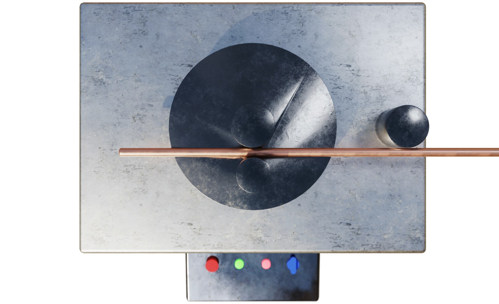

*Figura 6. Sistema de doblado y desplazamiento de la barra.*

El sistema de desplazamiento es impulsado por un servomotor Siemens, que transmite el movimiento rotacional a un rodillo con un alto coeficiente de fricción para asegurar el agarre de la barra.

En la figura 7 se ilustra el diseño final de la dobladora de barras con sus partes correspondientes.

*Figura 7. Vista isométrica del diseño final con sus partes señaladas.*

Un sensor es el encargado de verificar la presencia de una varilla en la máquina para así ponerla en marcha. Para esto, se usa un sensor inductivo.

Ahora, para lograr el ángulo especificado por el operario para cada doblez se hace uso de un encoder, controlando la posición de giro del motor principal acoplado al eje formador de la máquina.

A continuación, se calcula el momento necesario para la deformación de las varillas junto con el torque y la potencia requerida del motor.

Dado que lo que se va a doblar es una barra circular, se toma la fórmula del momento de inercia de una sección circular, como se observa en la figura 8.

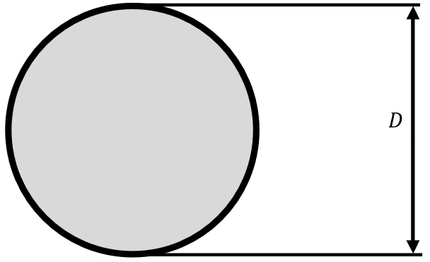

*Figura 8. Sección circular de una varilla.*

$$I=\frac{\pi}{64}D^{4} \qquad (1)$$

Donde: 
$I$ = Momento de inercia. 
$D$ = 0.0256 m.

$$I=\frac{\pi}{64}(0.0256\ \text{m})^{4} \qquad (2)$$

$$I=0.00000002108\ \text{m}^{4} \qquad (3)$$

Las propiedades mecánicas de los aceros metálicos estructurales circulares son:

Resistencia a la tracción: 310 MPa. 
Límite de fluencia: 228 MPa.

Con esto en mente, se calcula el momento plástico.

$$M_{P}=\frac{3\cdot\sigma_{y}\cdot I}{2\cdot C} \qquad (4)$$

Donde: 
$M_{P}$ = Momento plástico. 
$\sigma_{y}$ = Limite de fluencia. 
$C$ = Distancia del eje neutro a la fibra en estudio más alejada.

$$M_{P}=\frac{3\cdot\left(228\cdot 10^{6}\ \frac{\text{N}}{\text{m}^{2}}\right)\cdot\left(0.00000002108\ \text{m}^{4}\right)}{2\cdot(0.026\ \text{m})} \qquad (5)$$

$$M_{P}=277.28\ \text{N-m} \qquad (6)$$

A continuación, se calcula la fuerza requerida para doblar la varilla.

$$F=\frac{6\cdot\sigma_{y}\cdot I}{C\cdot L} \qquad (7)$$

Donde: 
$L$ = Radio de la matriz de doblado.

$$F=\frac{6\cdot\left(228\cdot 10^{6}\ \frac{\text{N}}{\text{m}^{2}}\right)\cdot\left(0.00000002108\ \text{m}^{4}\right)}{(0.026\ \text{m})\cdot(0.0765)} \qquad (8)$$

$$F=14484.70\ \text{N} \qquad (9)$$

Una vez calculada la fuerza, para saber si es ideal para doblar la varilla, se debe cumplir lo siguiente:

$$\sigma_{y}<\sigma_{d} \qquad (10)$$

Siendo $\sigma_{d}$:

$$\sigma_{d}=\frac{M_{p}\cdot C}{I} \qquad (11)$$

$$\sigma_{d}=\frac{277.28\ \text{N-m}\cdot 0.026\ \text{m}}{0.00000002108\ \text{m}^{4}} \qquad (12)$$

$$\sigma_{d}=341.99\ \text{MPa} \qquad (13)$$

Entonces:

$$\sigma_{y}<\sigma_{d} \qquad (14)$$

$$228\ \text{MPa}<341.99\ \text{MPa} \qquad (15)$$

Seguido a esto, se calcula el torque requerido sabiendo que: 
$F$ = 14484.70 N 
$L$ = 0.0765 m

$$T=F\cdot L \qquad (16)$$

$$T=14484.70\ \text{N}\cdot 0.0765\ \text{m} \qquad (17)$$

$$T=1108.07\ \text{N-m}=817.27\ \text{lbf-ft} \qquad (18)$$

Con esto, se calcula la potencia requerida del motor.

Hay que tener en cuenta la velocidad con la que se va a doblar el tubo, por esto, la velocidad angular del motor se define como $\omega$ = 0.5 rad/s.

$$P=T\cdot\omega \qquad (19)$$

$$P=817.27\ \text{lbf-ft}\cdot 0.5\ \frac{\text{rad}}{\text{s}}\cdot\left(\frac{1\ \text{HP}}{550\ \text{lbf-ft}}\right) \qquad (20)$$

$$P=0.7429\ \text{HP} \qquad (21)$$

Una vez encontrada la potencia requerida para doblar una varilla, se considera que con un motor de un caballo de potencia es más que suficiente para el calibre de las varillas con las que se planea trabajar.

Sabiendo estos datos, se elige un motor en el catálogo de motores *Simotics* de SIEMENS, donde se ve que el modelo que mejor cumple los requerimientos a menor costo es el motor con referencia 1LE0141-0EC06-4AA4-Z. Este es un motor de 6 polos con una eficiencia del 73%. Su velocidad, potencia y torque nominal y factor de potencia (FP) son de 1130 RPM, 1 HP, 6.3 Nm y 0.81 respectivamente.

Ahora, se parametrizan los motores a emplear con énfasis en la selección correcta de los atributos del motor para que opere de manera óptima.

**Parametrización motor Siemens:**

En primer lugar, para la parametrización del motor Siemens, encargado del desplazamiento de la varilla, se hace la selección del motor a usar, teniendo en cuenta la potencia mínima calculada para el motor, por lo que se elige un motor con una potencia de 0.75 kW, como se observa en la figura 9.

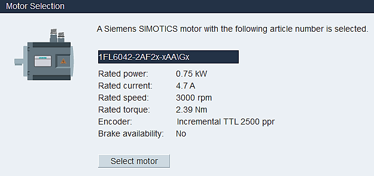

*Figura 9. Selección del motor en SINAMICS V-ASSISTANT.*

Seguido a la selección del motor, se hacer la selección del *driver*, como se observa en la figura 10. En conjunto, el motor y el *driver* forman un circuito para comandar posición, torque y velocidad.

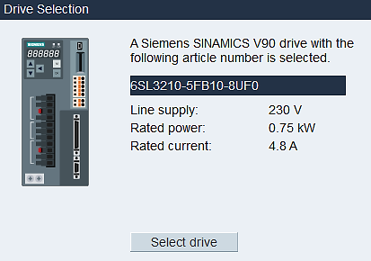

*Figura 10. Selección del driver en SINAMICS V-ASSISTANT.*

En la figura 11 se ve cómo para esta aplicación, se selecciona el modo de control de posición, pues la velocidad no será variable.

*Figura 11. Selección del modo de control en SINAMICS V-ASSISTANT.*

Una vez seleccionados el motor y el *driver*, se selecciona el modo de control de posición básico. En este caso, el modo más apropiado para esta aplicación es el de tabla de disco, observado en la figura 12.

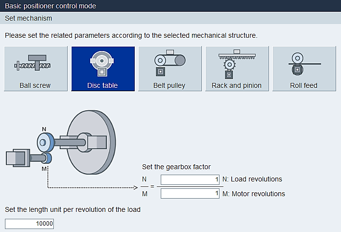

*Figura 12. Selección del modo de control de posición en SINAMICS V-ASSISTANT.*

Finalmente, se selecciona el pulso para la dirección de giro y el nivel de la señal, o sea, 5 V.

**Parametrización motor Yaskawa:**

La parametrización del motor Yaskawa para el doblado de las varillas se realiza en el software proveído oficialmente por Yaskawa. Para esto, primero, se selecciona en *encoder* serial, mostrado en la figura 13.

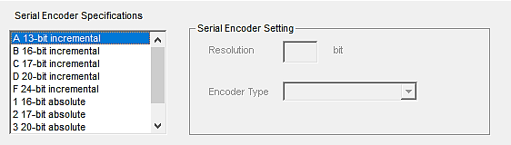

*Figura 13. Selección del encoder serial en SigmaWin+ Ver. 7.*

Después, se selecciona el modo de control que se desea usar. En este caso, al igual que en el motor Siemens, se usa el modo de posición de control, como se muestra en la figura 14.

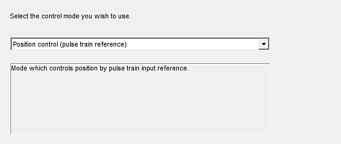

*Figura 14. Selección del modo de control en SigmaWin+ Ver. 7.*

A continuación, se selecciona una forma de pulso para que vaya del controlador del *host* al servomotor, como se observa en la figura 15.

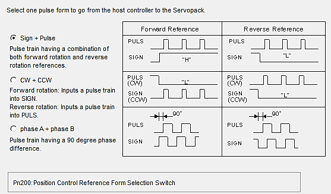

*Figura 15. Selección de la forma del pulso en SigmaWin+ Ver. 7.*

Ahora, se selecciona un tipo de lógica para la configuración de pulso, visto en la figura 16.

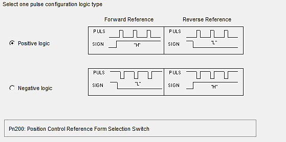

*Figura 16. Selección de la configuración de la lógica en SigmaWin+ Ver. 7.*

Posteriormente, se hace la sección de la estructura mecánica del equipo electrónico, como se ve en la figura 17.

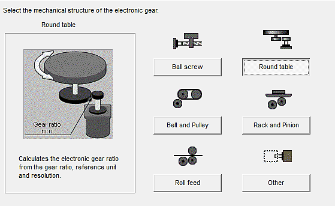

*Figura 17. Selección de la estructura mecánica en SigmaWin+ Ver. 7.*

Entonces, se procede a seleccionar la relación de los engranajes del servomotor, como se observa en la figura 18.

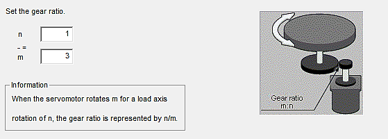

*Figura 18. Selección de la relación de engranajes en SigmaWin+ Ver. 7.*

Finalmente, se realiza la selección del número de pulsos por cada rotación del motor. Para una precisión adecuada, se usan 2048 pulsos por rotación, como se muestra en la figura 19.

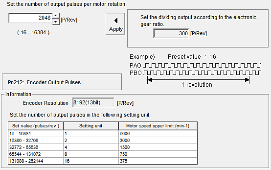

*Figura 19. Selección de los pulsos de salida por rotación del motor en SigmaWin+ Ver. 7.*

**Aplicación para generar las coordenadas de cada forma:**

Se hace uso de un Arduino en donde se programan los grados exactos que necesita moverse el motor para crear las figuras deseadas, para ello se tuvo en cuenta la resolución escogida en la parametrización del motor Yaskawa, o sea, 2048 pulsos por rotación. Por lo tanto, para la configuración de un cuadrado, se plantea que, al ser 4 dobleces de 90 grados, se toma la relación como 2048/4 = 512 cuatro veces, para el triángulo 2048/3 = 682 tres veces.

**Análisis económico:**

Sabiendo los datos exactos de los motores y las medidas de la máquina, se puede realizar la tabla de presupuesto final.

**TABLA I. TABLA DE PRESUPUESTOS**

| Presupuesto Dobladora de Barras | |
|---|---:|
| Motor Siemens | \$ 803.000 |
| Motor Yaskawa | \$ 1.800.000 |
| Rodillos de acero | \$ 130.000 |
| Láminas de aluminio (x10) | \$ 1.400.000 |
| Rodamientos | \$ 25.900 |
| Tablero Eléctrico | \$ 359.000 |
| Correa dentada | \$ 60.900 |
| Sensor de proximidad | \$ 96.500 |
| Encoder | \$ 260.000 |
| Cables | \$ 89.900 |
| **Total** | **\$ 5.025.200** |

Adicional a esto, no se puede dejar a un lado el costo de la ingeniería. Para este caso, se calculó una cifra del 15% del total de los materiales, siendo este valor \$753.780.

## IV. Conclusiones

Se lograron desarrollar las habilidades necesarias para el diseño óptimo de una dobladora de varillas, desarrollando los criterios para una elección y parametrización de motores eficaz aplicando todas las precauciones necesarias para el mismo, intentando reducir al máximo los costos, cosa que se logró, ya que el valor promedio de una dobladora de barras en el mercado actual es hasta 3 veces mayor al logrado en este caso.

En el caso de venir de una máquina manual, con la automatización del proceso de doblado de varillas, se logra disminuir el porcentaje de lesiones en los operarios por exceso de sobreesfuerzos físicos repetitivos, logrando que realicen esta labor con mayor seguridad evitando a la empresa costos adicionales ocasionados por incapacidades o indemnizaciones.

Reduciendo el tiempo de fabricación de las estructuras por un 80%, se obtiene un beneficio económico adicional al obtenido por los tiempos de producción, por ejemplo, al usar máquinas manuales y disminuyendo el error causado por estos procesos, como arrugas en las barras.

## Referencias

[1] McGuire, Patrick M., Conveyors: Application, Selection, and Integration, 2009. 
[2] Klempner, Geoff, Kerszenbaum, Isidor. Operation and Maintenance of Large Turbogenerators, Estados Unidos, 2004. 
[3] William D. Stevenson, Jr., Elements of Power System Analysis, 3ra ed, McGraw-Hill, New York, 1975. 
[4] Pinometal: Nimbo 3” Aluminum intercooler piping manufacturer [Online]. Disponible en: https://www.alibaba.com/ 
[5] Cárdenas V. Introducción al conformado mecánico. Quito, Ecuador, 1989. 
[6] Doyle, Lawrence E. Materiales y Procesos de Manufactura para Ingenieros, México, 1988. 
[7] Umss, Formado de metales y trabajo con lámina metálica, Trabajo metálico de láminas, Operaciones de doblado, Online, Disponible en: http://materias.fcyt.umss.edu.bo 
[8] Serway, R. A. y Jewett, Jr. J.W. Physics for Scientists and Engineers. 6ta Ed., Londres, 2003.
